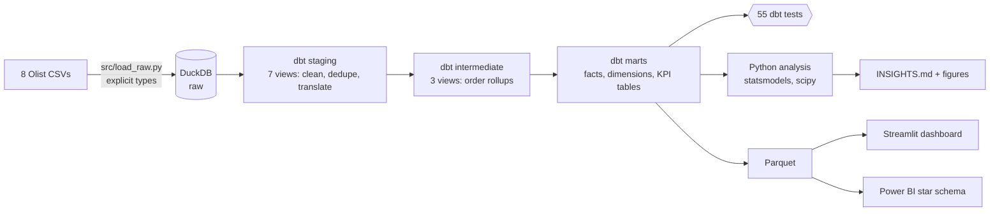
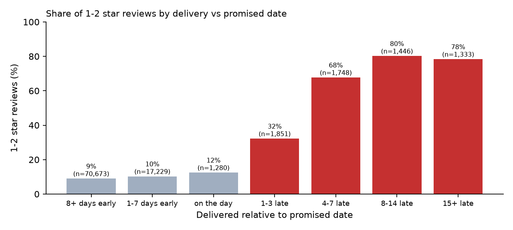
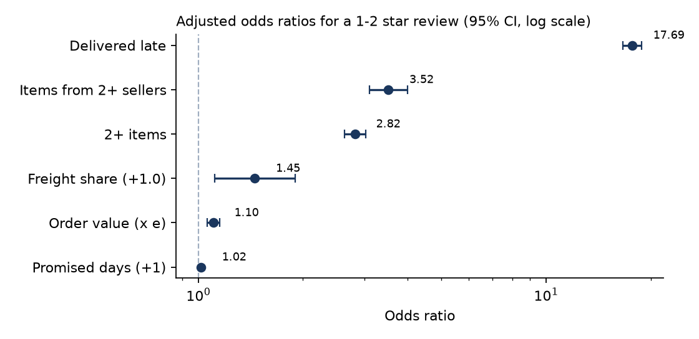
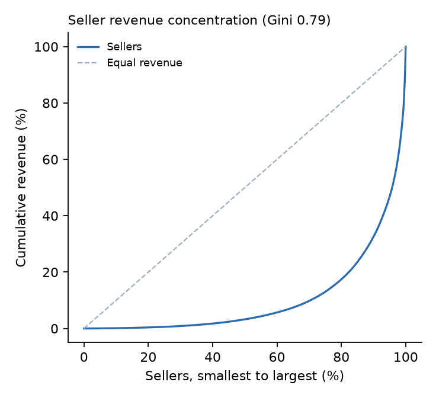
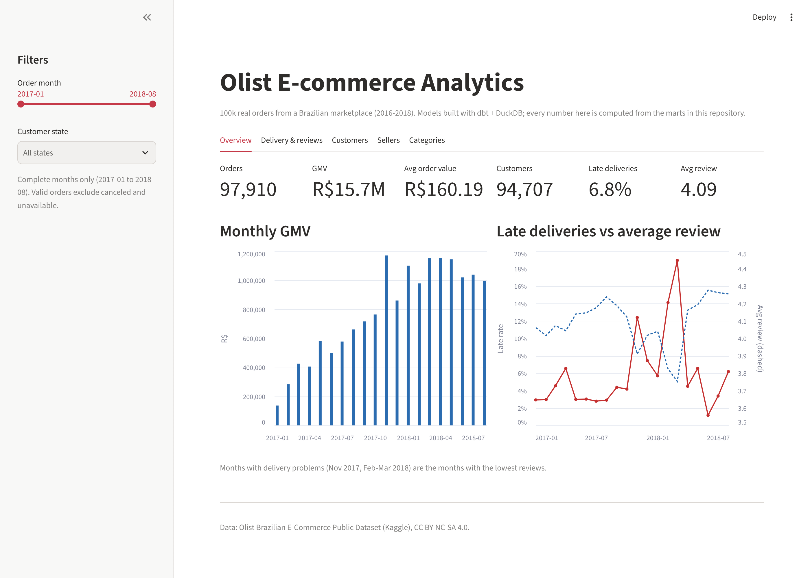
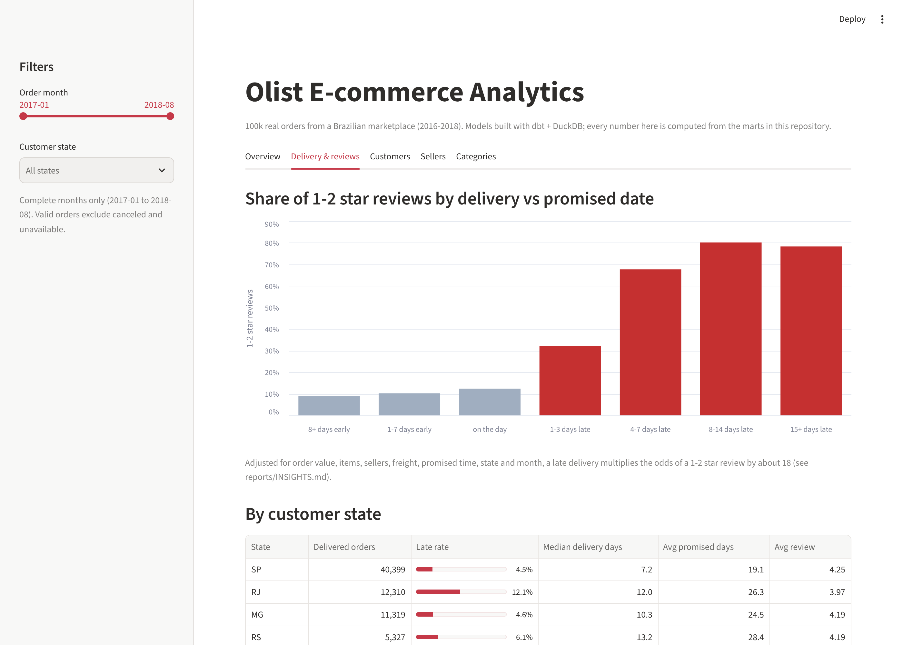
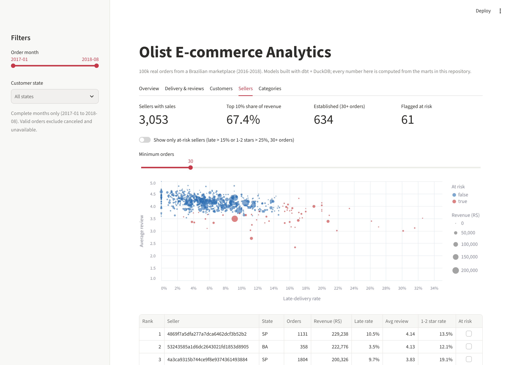

# Olist E-commerce Analytics

An end-to-end analytics project on **~100,000 real orders** from Olist, a Brazilian online
marketplace (2016-2018): raw CSVs are modelled into a tested star schema with **dbt + DuckDB (SQL)**,
analysed in Python (logistic regression, cohort retention, seller concentration) and served in a
**Streamlit dashboard** and a **Power BI** model.

> **Key findings**
> - **Late delivery is the biggest driver of bad reviews.** 1-2 star reviews go from 9.2% for orders delivered on
>   time to 68% for orders 4-7 days late. Adjusted for order value, items, sellers, freight, promised delivery time,
>   state and month, a late delivery multiplies the odds of a 1-2 star review by **17.7** (95% CI 16.6-18.8).
> - **Only 2.2% of customers ever buy again** on a later day. 28% of apparent "repeat customers" were really
>   split checkouts on the same day.
> - **The top 10% of sellers bring 67% of revenue**; 129 of 3,053 sellers make half of it. 61 established sellers are flagged
>   at risk (late or badly reviewed).

## Business questions
1. What drives bad reviews, and how much does late delivery matter after controlling for other factors?
2. Do customers come back, and does a bad first experience stop them?
3. How dependent is the marketplace on a few sellers, and which sellers put customer experience at risk?
4. Which categories and regions grow, and where do deliveries fail?

## Architecture


| Layer | Models | What happens |
|---|---|---|
| Staging | `stg_orders`, `stg_customers`, `stg_order_items`, `stg_payments`, `stg_reviews`, `stg_products`, `stg_sellers` | Renaming, typing, delivery metrics (`days_late`), one review per order, English category names |
| Intermediate | `int_order_items_agg`, `int_order_payments`, `int_customer_orders` | Item and payment rollups per order; orders numbered per real customer |
| Marts | `fct_orders`, `fct_order_items`, `dim_customers`, `dim_products`, `dim_sellers`, `dim_date` | Star schema (one row per order / item / customer / product / seller / day) |
| Marts | `mart_monthly_kpis`, `mart_cohort_retention`, `mart_category_performance`, `mart_state_delivery`, `seller_scorecard` | Business-ready KPI tables |

## Data quality
Profiling the source found real problems. Each one has a dbt test (warning level, because they are
facts about the source) and a documented handling in the models. Full report: `reports/DATA_QUALITY.md`.

| Issue | Rows | Handling |
|---|---|---|
| `customer_id` is a per-**order** key | 99,441 ids for 96,096 people | Customers are identified by `customer_unique_id`; otherwise everyone looks like a first-time buyer |
| Orders with 2-3 reviews | 547 orders | Latest answered review kept |
| Orders with no items | 775 (767 canceled/unavailable) | Excluded from revenue |
| Payments differ from items + freight by > R$1 | 249 orders | Revenue = items + freight; payments kept separately |
| "Delivered" with no delivery date | 8 | Excluded from delivery metrics |
| Products with no category / untranslated category | 610 / 2 categories | `unknown` / Portuguese name kept |
| Sparse months at the edges (2016-09 to 2016-12, 2018-09, 2018-10) | | Trends use complete months 2017-01 to 2018-08 |

Integrity tests that must pass: unique and not-null keys, foreign keys, accepted values, value
ranges, and **reconciliation between layers** (no item lost between staging and marts; monthly GMV in the KPI table equals the
order-level total). Result: **46 pass, 9 warn (the known issues above), 0 fail**.

## Results
All numbers are produced by the pipeline (`reports/INSIGHTS.md`, `reports/business_questions.md`).

| Metric | Value |
|---|---|
| Valid orders (not canceled / unavailable) | 98,207 |
| GMV (items + freight) | R$15.74M |
| GMV growth, H1 2018 vs H1 2017 | 2.8x |
| Average order value | R$160.24 |
| Delivered after the promised date | 6.8% |
| Average review | 4.09 / 5 |
| Customers who bought again on a later day | 2.2% |

### 1. Late delivery and reviews


Logistic regression on 95,560 delivered, reviewed orders (outcome: 1-2 star review; standard errors
clustered by customer):



- Late delivery: **odds ratio 17.7** (95% CI 16.6-18.8). Predicted 1-2 star rate: 61% if every order were late vs 9% if all were on time.
- Orders with items from **2+ sellers** (OR 3.5) and **2+ items** (OR 2.8) are also reviewed worse, consistent with parts of
  an order arriving separately.
- A longer *promised* time barely matters (OR 1.017 per day): **missing the promise** is what customers punish.
- Monthly view: the three months with the worst reviews (Nov 2017, Feb 2018, Mar 2018) are the three months with the most late deliveries.

### 2. Retention
- Month-1 retention averages 0.48% across 19 cohorts. Returning customers come back after a median of 74 days.
- After a 1-2 star first order, 2.2% return vs 3.0% after 4-5 stars (chi-square p < 0.001): a bad first order hurts,
  but even satisfied customers rarely return, so retention is a structural problem.

### 3. Sellers


- Top 1% of sellers: 26.2% of revenue; top 10%: 67.4%; Gini 0.79.
- 61 of 634 established sellers (30+ orders) are at risk: late 15.2% of the time (others 5.6%), 1-2 stars 28.0% of the time
  (others 12.3%).

### 4. More from SQL (`sql/business_questions.sql`)
- Black Friday (2017-11-24) had 1,166 orders, **4.7x** an average November day.
- Orders shipped from another state are late 7.8% of the time vs 4.5% within the same state.
- Credit card covers 75% of orders; average order value rises from R$101 (1 installment) to R$335 (7+).
- 77% of 1-star reviews include a written comment vs 36% of 5-star reviews.

### Recommendations
1. Set more accurate delivery promises in the states that miss them most (MA, CE, BA, RJ, PA: 11-17% late vs 4.5% in SP).
2. Put at-risk sellers on an improvement plan using the scorecard, starting with the highest-revenue ones.
3. Warn about or consolidate multi-seller orders.
4. Test (A/B) a second-purchase offer timed around the 74-day median return gap.
5. Grow mid-tier sellers to reduce dependence on the top 10%.

## Dashboard
`streamlit run app.py`: five tabs (Overview, Delivery & reviews, Customers, Sellers, Categories) with month
and state filters. It reads the Parquet marts in `data/marts/`, so it runs without the raw data.



| Delivery & reviews | Sellers |
|---|---|
|  |  |

Power BI: `powerbi/BUILD_GUIDE.md` (star-schema relationships, Power Query loading) and `powerbi/measures.dax`
(20 DAX measures including time intelligence).

## Run it
```bash
pip install -r requirements.txt
# put the 8 Olist CSVs in data/raw/ (see data/README.md)
python run_pipeline.py      # load -> dbt build + tests -> reports -> Parquet (about 15 s)
streamlit run app.py
python -m pytest -q         # 19 tests
```
Step-by-step instructions: `docs/RUN_GUIDE.md`.

## Repo map
```
dbt/models/staging|intermediate|marts   SQL models (+ schema tests in _*.yml)
dbt/tests/                              data-quality and reconciliation tests
dbt/macros/                             generic tests, schema naming
sql/business_questions.sql              10 ad-hoc business questions (window functions, CTEs)
src/                                    load raw CSVs, data-quality report, Parquet export
analysis/                               logistic regression, retention, seller concentration, report builder
app.py                                  Streamlit dashboard
powerbi/                                Power BI build guide and DAX measures
reports/                                INSIGHTS.md, DATA_QUALITY.md, business_questions.md, figures
data/marts/                             Parquet marts (CC BY-NC-SA 4.0)
tests/                                  pytest: marts integrity + helper code
```

## Limitations
- Observational data: the late-delivery effect is a strong adjusted association, not a proven causal effect
  (unmeasured factors such as product quality could contribute).
- The data ends in 2018 and covers one marketplace; the numbers describe Olist, not e-commerce in general.
- Reviews are only from customers who answered the survey.
- Revenue is item price + freight as recorded; Olist's commission and costs are not in the data.

## Data
Brazilian E-Commerce Public Dataset by Olist, [Kaggle](https://www.kaggle.com/datasets/olistbr/brazilian-ecommerce),
CC BY-NC-SA 4.0. Code: MIT license.
