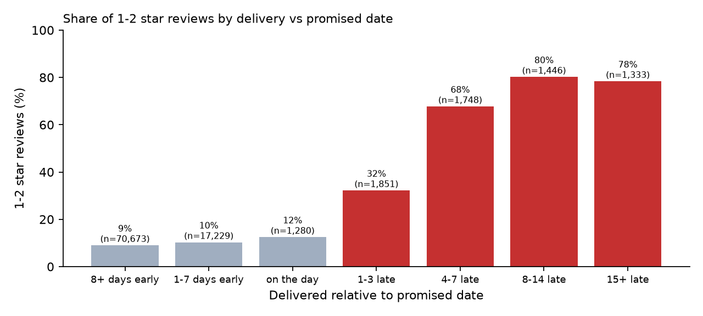
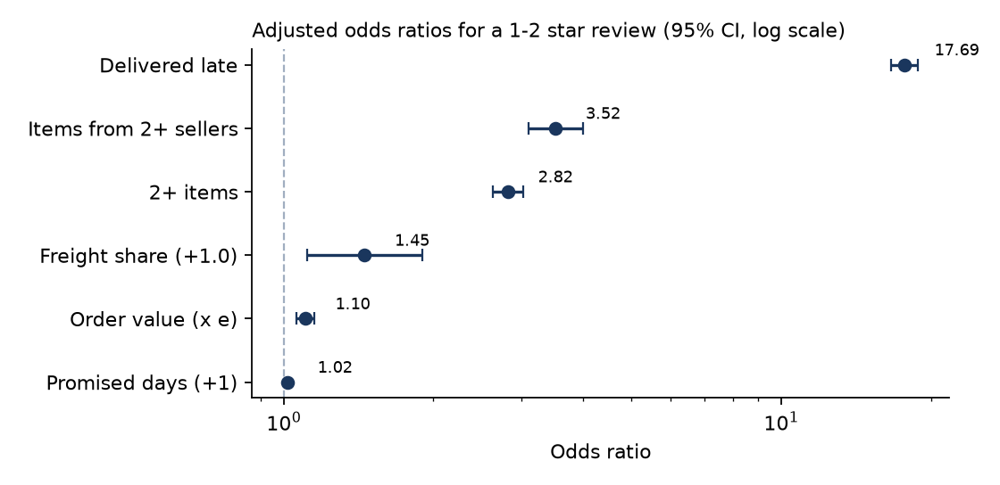
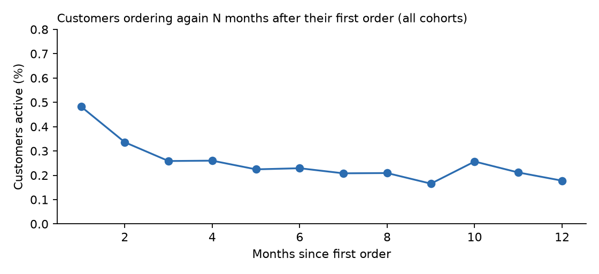
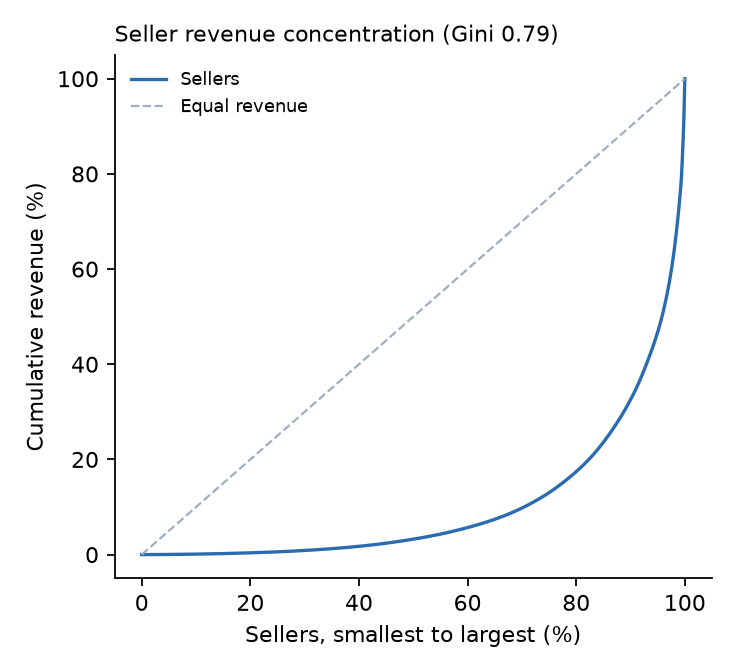
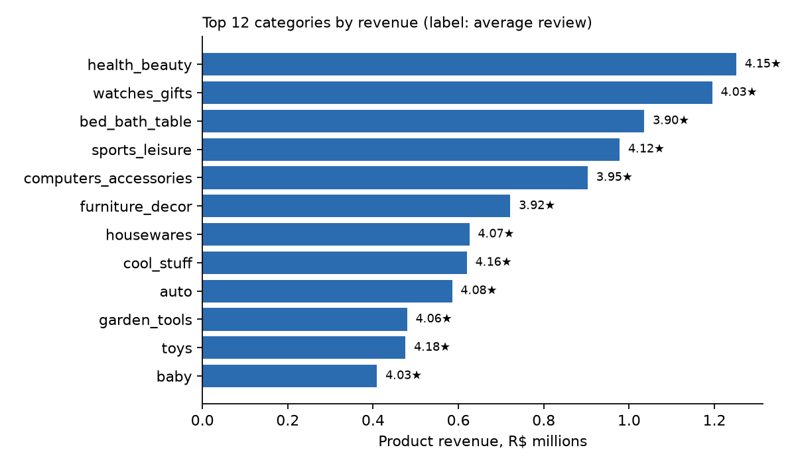
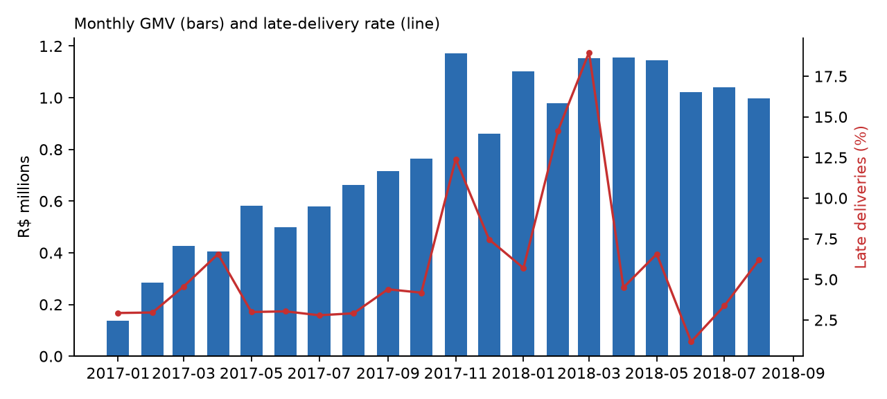

# Insights (auto-generated by `python -m analysis.build_report`, do not edit)

Data: 99,441 orders (2016-09-04 to 2018-10-17), 94,990 customers, 3,095 sellers. Trends use complete months only (2017-01 to 2018-08).

## Headline numbers

| Metric | Value |
|---|---|
| Valid orders (not canceled / unavailable) | 98,207 |
| GMV (items + freight, valid orders) | R$15.74M |
| Average order value | R$160.24 |
| GMV growth, H1 2018 vs H1 2017 | 180.9% (2.8x) |
| Delivered after the promised date | 6.8% |
| Median delivery time | 10.2 days |
| Average review score | 4.09 / 5 |
| Customers who bought again on a later day | 2.2% (2,065) |
| Revenue from the top 10% of sellers | 67.4% |

## 1. Late delivery is the strongest driver of bad reviews

- Orders delivered early or on time get a 1-2 star review **9.2%** of the time; orders 4-7 days late **68%**, 8-14 days late **80%**.
- Logistic regression on 95,560 delivered, reviewed orders, controlling for order value, item count, multiple sellers, freight share, promised delivery time, customer state and month: **odds ratio 17.7** (95% CI 16.6-18.8, p < 0.001) for a 1-2 star review when late (unadjusted 16.3).
- In probability terms: the model predicts a **61%** chance of a 1-2 star review if every order were late vs **9%** if every order were on time.
- Orders split across **2+ sellers** (odds ratio 3.5) and with **2+ items** (2.8) are also reviewed worse, consistent with parts of the order arriving separately or missing.
- This is observational data: lateness is not randomly assigned, so the odds ratio is a strong association after controls, not a proven causal effect.

## 2. Almost nobody comes back

- Only **2.2%** of 94,990 customers bought again on a later day; they bring 4.2% of revenue.
- 823 of the 2,888 customers with 2+ orders placed them all on the same day (split checkouts), so counting orders per customer overstates retention by 28%.
- Month-1 retention averages **0.48%** across 19 cohorts. Returning customers came back after a median of 74 days.
- Customers whose first order got 1-2 stars returned 2.2% of the time vs 3.0% after 4-5 stars (chi-square p < 0.001). A bad first experience lowers return, but even happy customers rarely come back: retention is a structural problem, not only a service problem.

## 3. Revenue depends on a small group of sellers

- The top 1% of sellers bring **26.2%** of product revenue, the top 10% **67.4%**, and just **129** of 3,053 sellers make half of it (Gini 0.79).
- Of 634 established sellers (30+ orders), **61** are flagged at risk (late rate > 15% or 1-2 star rate > 25%). They hold 5.8% of revenue, deliver late 15.2% of the time (others 5.6%) and get 1-2 stars 28.0% of the time (others 12.3%).

## 4. Categories and regions

| Category | Revenue | Share | Avg review | Late rate | Growth H1 18 vs 17 |
|---|---|---|---|---|---|
| health_beauty | R$1.25M | 9.3% | 4.15 | 7.6% | 234% |
| watches_gifts | R$1.19M | 8.9% | 4.03 | 7.2% | 301% |
| bed_bath_table | R$1.04M | 7.7% | 3.90 | 7.0% | 204% |
| sports_leisure | R$977,729 | 7.3% | 4.12 | 6.3% | 191% |
| computers_accessories | R$902,923 | 6.7% | 3.95 | 6.5% | 188% |
| furniture_decor | R$721,584 | 5.4% | 3.92 | 7.1% | 148% |
| housewares | R$625,539 | 4.7% | 4.07 | 5.0% | 217% |
| cool_stuff | R$619,724 | 4.6% | 4.16 | 5.9% | 43% |
| auto | R$585,177 | 4.4% | 4.08 | 7.0% | 174% |
| garden_tools | R$479,650 | 3.6% | 4.06 | 6.6% | 73% |

Lowest-rated large categories (500+ orders): office_furniture (3.50), bed_bath_table (3.90), furniture_decor (3.92).

States with the most late deliveries (500+ delivered orders):

| State | Delivered orders | Late rate | Median delivery days | Avg review |
|---|---|---|---|---|
| MA | 717 | 17.4% | 19.2 | 3.83 |
| CE | 1,279 | 13.8% | 18.2 | 3.94 |
| BA | 3,256 | 12.2% | 16.9 | 3.93 |
| RJ | 12,350 | 12.1% | 12.0 | 3.96 |
| PA | 946 | 11.2% | 21.1 | 3.91 |
| SP (largest, for comparison) | 40,494 | 4.5% | 7.2 | 4.25 |

## Recommendations

1. **Make delivery promises realistic where they are missed most.** Missing the promised date matters far more than the promise itself (each extra promised day: odds ratio 1.017; being late: 17.7), and orders arriving early are rated best. Promising more accurate dates in the late-prone states above is a cheap first step to test.
2. **Put the at-risk sellers on an improvement plan** with the scorecard (late and 1-2 star rates), starting with those with the most revenue.
3. **Warn about or consolidate multi-seller orders**, which are reviewed much worse.
4. **Invest in a second purchase**: with ~2% repeat, a post-delivery offer timed around the observed median gap (74 days) is worth testing with an A/B test before rolling out.
5. **Reduce dependence on top sellers** by onboarding and supporting mid-tier sellers.
